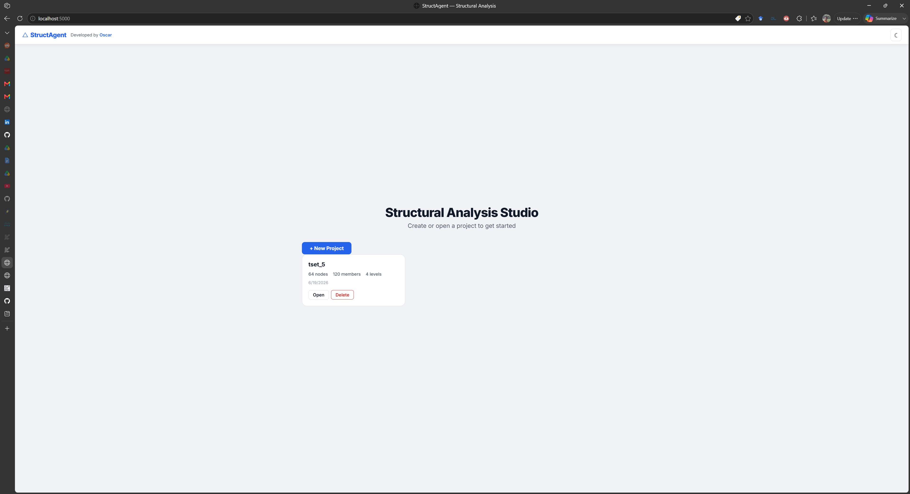
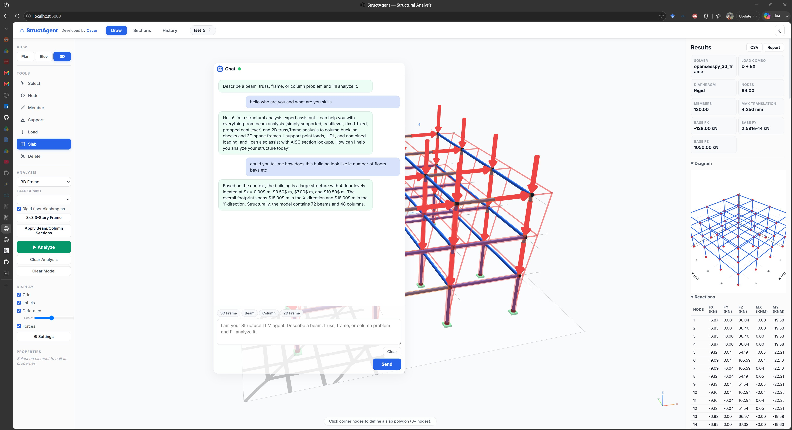
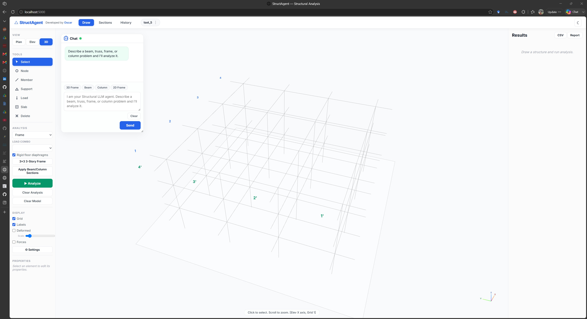
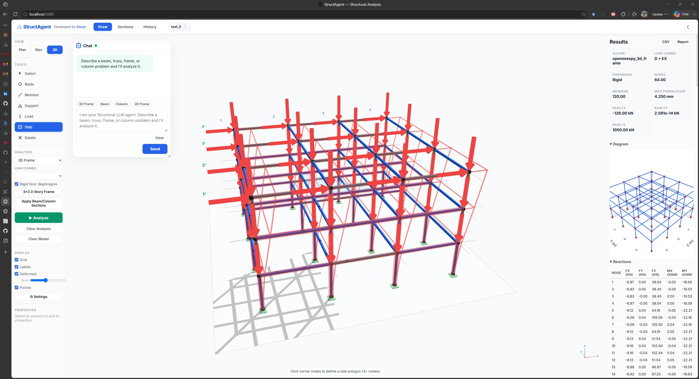
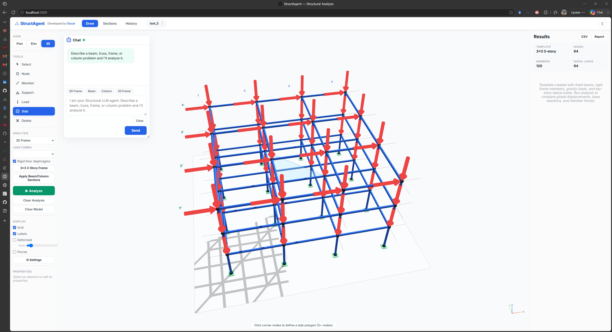

# StructAgent — Multi-Agent LLM Structural Analysis

A Flask-based structural analysis assistant that combines conversational AI agent workflows, an interactive browser-based 3D modeling canvas, deterministic engineering tools, and OpenSeesPy. This project supports preliminary elastic beam, truss, 2D frame, column buckling, and 3D space-frame analysis — all through a chat interface and an interactive 3D canvas.

This software is intended for research, education, experimentation, and early-stage engineering assistance. It is **not** a substitute for review, approval, or design work by a licensed professional engineer.

---

## Public demo deployment

The public on-demand deployment is available at [StructAgent landing page](https://structagent.oscarp.com.np) with the workspace at [StructAgent workspace](https://structagent-app.oscarp.com.np). The gateway stays online while the compute container starts on visitor request and stops after 30 minutes without visible workspace heartbeats, or after a two-hour maximum session. Visitors share the same compute container and SQLite data, so do not upload private projects. A running Ollama server is configured separately and is not stopped by the idle timer.

For portable Ubuntu installation, configuration, existing Cloudflare Tunnel routing, shutdown testing, service restarts and troubleshooting, see **[deploy/README.md](deploy/README.md)**.

---


## Project creation and workspace layout

Click **New Project** on the app dashboard. The wizard now requests a required **project name** and optional project number, client, engineer/preparer, project location, structure type, reference standard and design notes. Grid spacings and story elevations are configured beneath the project information. The project is **not saved** until the required name, X/Y grid spacings and valid story elevations are confirmed with **Create Project & Start Drawing**; Cancel discards the draft.

Saved project details appear in the project cards. For an existing project, open the project menu in the top bar and select **Edit Project Information**. These fields persist with the model and are included in exported Markdown/PDF calculation reports. Older projects remain compatible and acquire optional metadata when edited.

Project information is **descriptive metadata**; selecting a country or code basis does not automatically convert the load combinations or design methods. Confirm the actual governing edition at each engineering check. The setup page is scrollable between the fixed top navigation and status bar, and its action footer remains visible without hiding story-level inputs. On a smaller screen, the form switches to one column.

Project metadata and geometry validation are covered by `tests/test_project_metadata.mjs` and run with `node --test` in CI. The public demo still shares project storage across visitors: do not enter private client or site information unless per-user authorization and isolation have been implemented.

## Engineering workflow upgrade: code checks, second-order comparison and Ollama design

The **Analyze** ribbon supports representative ASCE 7-22 strength-combination templates, a selectable **P-Delta (3D)** geometric-transformation option, and the **Code Review** workspace. It exposes deterministic directional X/Y story-drift screening against selected ASCE/SEI 7-22 Table 12.12-1 limits, an independently specified AISC 360-22 H1 axial-bending interaction check, and a project-selected serviceability L/N comparison.

The chat assistant can route explicitly stated steel design demands through your configured **Ollama** model to select deterministic engineering tools. Ollama does not determine capacities or numerical PASS/FAIL values. When required values are missing, the assistant asks for them. Example chat requests:

```text
Design steel beam Mu=220 kN-m, Vu=80 kN, Lb=3 m, Fy=345 MPa
Design steel column Pu=400 kN, KL=4 m, Fy=345 MPa
Check steel H1 interaction Pr=20 kN, Pc=100 kN, Mrx=30 kN-m, Mcx=100 kN-m, Mry=10 kN-m, Mcy=100 kN-m
```

The beam and column shape selection functions use the **existing limited W-shape selection library and AISC 360-16-inspired calculations**. They provide preliminary candidates, not complete AISC 360-22 member design. For H1, **Pc, Mcx and Mcy must be independently calculated available strengths** from the correct LRFD or ASD procedure. The LLM cannot invent them.

The 3D P-Delta option uses an OpenSees `PDelta` geometric transformation and compares the maximum translation from that run with the selected load combination analyzed using a first-order `Linear` transformation. It is **not** a complete AISC 360-22 Chapter C direct analysis method. It does not automatically model geometric imperfections, stiffness reductions, all notional loads, member curvature P-delta effects or required load cases.

Each canvas report now includes a UTC timestamp, model-input SHA-256 fingerprint, solver identity, selected combination, analysis order, directional story drifts (where available) and a scope disclaimer. The engineering regression suite includes analytical P-delta and drift checks, H1 branch tests, load-case sign tests, and an OpenSees cantilever first/second-order comparison.

For test cases, assumptions, calculation scope and validation instructions, see **[Engineering verification guide](docs/ENGINEERING_VALIDATION.md)**. No output should be used as construction approval without independent analysis and licensed engineering review.


---

## Screenshots

| Dashboard | Chat Agent |
|---|---|
|  |  |
| **3D Modeling Canvas** | **After Analysis** |
|  |  |
| **Modeled Building** |
|  |

---

## Features

### Conversational AI Agent
- Chat interface for greetings, capability questions, and engineering requests
- **Multi-agent system**: a team of specialist LLM agents — Router, Intent, Planner, Extractor, Critic, and Reporter — coordinate every request via native tool-calling (typed JSON schemas)
- **Context-aware chat**: the agent sees the current 3D model and analysis results, answering questions about geometry, loads, floors, drifts, reactions, member forces, and more
- **Canvas tool routing**: the agent can draw beams, create 3D frame templates, apply member sections, toggle rigid diaphragms, set load combinations, and clear analysis results — all from natural language
- **LLM connection status indicator**: green/yellow/red dot in the chat header and bottom status bar showing live connectivity
- Deterministic *solvers* (OpenSeesPy, closed-form) remain the source of every number; a compact deterministic fallback is used only when no LLM is reachable, so the app still works offline

### Interactive 3D Modeling Canvas
- **ETABS-style ribbon** command bar with grouped tabs — Model (templates, sections, file I/O), Loads, Design, Analyze (type, load combination, diaphragms, run/clear), and View (display toggles, scale, settings)
- 3D canvas with grids, floor levels, plan/elevation/3D views, snapping, and axis labels — **opens in 3D perspective view by default**
- **Camera presets** widget: Front / Back / Left / Right / Top / Bottom / Fit-to-view
- **Command palette** (`Ctrl`/`Cmd` + `K`): searchable runner for every action — run analysis, templates, loads, design tools, view modes, display toggles, export/import, theme
- **Model tree** panel: live list of nodes, members, and slabs with click-to-select (highlights in canvas and opens the property panel)
- Node, member, slab, and support tools for building structural models
- Beam/column/brace **member grouping** with one-click default section assignment
- Load assignment to `D`, `L`, `EX`, `EY` cases with nodal, member, and slab area loads
- **Rigid floor diaphragm** constraints for 3D floor levels
- Deformed shape and member force / story drift overlays with a **continuous color scale** and an on-canvas **result legend** (min/max + gradient)
- **Live status bar** showing node/member/load counts, active load combination, current tool, solver, and LLM connectivity
- Friendly **empty-state** overlay with quick-start templates when the canvas has no geometry

### Solver Engine
- OpenSeesPy-backed beam, truss, 2D frame, and 3D frame analysis paths
- Closed-form beam calculations for fallback and cross-checking
- 3D frame: base reactions, nodal displacements/rotations, member end forces and envelopes, story drifts, load-combination-controlled results
- Column buckling check
- Load combination processing (ASCE 7-22 LRFD + ASD: `1.0D + 1.0L`, `1.2D + 1.6L`, `1.2D + 1.0EX + 0.5L`, `1.2D + 1.0EY + 0.5L`, and more)

### Load Determination (deterministic, no LLM)
- **Wind** — ASCE 7-22 simplified MWFRS procedure: velocity pressure, exposure, gust factor, MWFRS pressures, internal pressure, base shear, story forces
- **Seismic** — ASCE 7-22 equivalent static force procedure: site coefficients, SDS/SD1, Cs, base shear, vertical story-force distribution
- **Snow** — ASCE 7-22 ground/flat/sloped roof snow load with simplified drift
- **Slab** — ACI 318 two-way slab coefficients, reinforcement, and deflection checks
- **Response spectrum** — multi-mode (Cantilever) SRSS analysis of a 3D model from vertical-member story stiffness
- **Story-force application** — map wind/seismic story forces onto the drawn 3D model as nodal loads, then analyze

### Element Design & Code Checks (deterministic, no LLM)
- **Code Review workspace:** ASCE/SEI 7-22 Table 12.12-1 seismic story-drift screening with user-confirmed Cd, Ie, risk category and structural class; per-story utilization table with explicit reference and limitations
- **Serviceability screening:** project-defined member deflection L/N comparison in the context of AISC 360-22 Chapter L, with no claim that one ratio is universally mandatory
- **Multi-color studio:** selectable Ocean, Teal, Violet and Copper palettes, enhanced workspace hierarchy and color-coded engineering checks
- **Steel section selection** — AISC 360: lightest adequate W-shape for flexure (incl. LTB, AISC F2) + shear, or axial (AISC E3)
- **Concrete design** — ACI 318 singly-reinforced beam (flexure, shear, stirrup spacing) and circular tied/spiral column
- **Timber design** — NDS rectangular beam with CD/CM/Ct/CF/CL factors, flexure/shear/stability/deflection
- **Foundations** — ACI 318 spread footing (bearing, one-way + punching shear, flexure) and static pile capacity (skin friction + end bearing, group efficiency)
- **Fatigue** — AISC 360 S-N curves (categories A–E), life check, allowable stress range
- **Cost estimation** — steel takeoff (section + length) with fabrication/erection factors

### Second-Order & Advanced Analysis
- **P-delta** — ASCE 7 stability-coefficient (θ = V·h/W) drift amplification + P-delta equivalent lateral forces for iterative second-order analysis
- **Sensitivity study** — OAT parametric study on a beam (moment/deflection/stress) with elasticity sensitivity coefficients and parameter ranking
- **Multi-hazard optimizer** — evaluates all ASCE 7 LRFD/ASD combinations against a member capacity and finds the worst-case scenario
- **Cross-validation** — compares closed-form, OpenSeesPy FEM, and direct-stiffness solvers on benchmark models

### API Documentation
- Auto-generated **OpenAPI 3.0** spec from live Flask routes + Pydantic models (`GET /api/openapi.json`)
- Self-contained interactive docs page (`GET /api/docs`)

### Project Persistence
- Server-backed project storage with SQLite — cross-browser (Chrome, Firefox, Edge)
- Autosave (every 2 seconds) and on `beforeunload`
- IndexedDB-to-server migration on first load

### Export & Reporting
- CSV and Markdown report export with detailed nested 3D analysis data
- Basic result critic for deflection limits, finite-value checks, and missing design inputs
- Markdown report generation with assumptions, warnings, and key results

---

## Current Scope

The solver paths support preliminary linear elastic analysis for **beams**, **trusses**, **2D frames**, **columns**, and **3D space frames**. For 3D frame models, the browser canvas can build geometry from grid/story levels, assign supports and member properties, apply nodal/member/slab loads, run OpenSeesPy, and report:

- Base reactions
- Nodal translations and rotations
- Member end forces and force envelopes
- Story displacements and story drift ratios
- Load-combination summaries
- Deformed shape and member force overlays
- CSV and Markdown exports with detailed nested result data

The 3D workflow is intended for ETABS-style preliminary comparison, not final design. In addition to first-order elastic analysis, the app now supports **P-delta second-order effects** (ASCE 7 stability-coefficient drift amplification + P-delta equivalent lateral forces) and **deterministic code design checks** (AISC 360 steel section selection with LTB, ACI 318 concrete beam/column, NDS timber, spread footing and pile foundations, and AISC 360 fatigue). Remaining limitations include limited member release handling, simplified section assignment, and preliminary (not construction-ready) detailing.

---

## Safety Notice

All outputs are preliminary and depend on the assumptions and units provided by the user. The assistant does **not** perform code compliance checks, load path validation, constructability review, connection design, detailing, or licensed engineering approval.

---

## Project Layout

```text
app/
  agents.py            Agent orchestration, context summarizer, canvas tool router
  config.py            Environment-driven settings (Pydantic-Settings + .env)
  llm.py               Ollama, PydanticAI, and Disabled LLM clients
  main.py              Flask app factory, DB init, LLM status check, blueprints
  models.py            Pydantic request/response models (Chat, Analyze, Canvas, etc.)
  logging_config.py    Structured logging (JSON + console)
  routes/
    analyze.py         Chat, analyze, evaluate, llm-status, load-combos, sensitivity, multi-hazard, validate
    design.py          Steel/concrete/timber/foundation/fatigue/cost design endpoints
    loads.py           Wind, seismic, snow, slab, response-spectrum, P-delta, story-forces, cross-validation
    history.py         Analysis history + CSV/report/PDF export
    pages.py           Static page serving, health check, OpenAPI spec + docs page
    projects.py        Project CRUD with SQLite
    sections.py        AISC section lookup
  static/
    index.html         Main application page
    styles.css         Full UI styling (glass design, ribbon, topbar, canvas, chat, modals, status bar)
    js/
      chat.js          Chat UI, context builder, LLM status polling, canvas actions
      analysis.js      Model payload builder, drawing functions, analysis runner
      state.js         Global state (S) with nodes, members, loads, results
      main.js          App initialization, project grid, autosave
      ribbon.js        ETABS-style ribbon (tabs, actions, height sync, empty-state)
      modelTree.js     Model tree panel (nodes/members/slabs, click-to-select)
      commandPalette.js Ctrl+K searchable command runner
      viewPresets.js   Camera preset widget (front/back/left/right/top/bottom/fit)
      statusbar.js     Bottom status bar (live model stats, LLM indicator, empty-state)
      canvas3d/        Three.js 3D canvas (render, interaction, scene, ui, export)
        colorScale.js  Continuous result color scale shared by overlays + legend
      results.js       Results panel, CSV/Markdown export, force overlays
      sections.js      AISC section browser
      projects.js      Server-side project persistence with fallback
      history.js       Analysis history panel
      api.js           API fetch wrappers
      dom.js           DOM helpers
      tabs.js          Large tool popup manager (loads/sections/history)
      shortcuts.js     Keyboard shortcuts
      modals.js        Nodal load, member load, slab dialogs
    tools/
    beam.py            Closed-form beam calculations (SS, cantilever, fixed, propped)
    opensees_beam.py   OpenSeesPy beam analysis tool
    opensees_3d.py     OpenSeesPy 3D frame analysis tool
    frame.py           2D frame analysis
    truss.py           2D truss analysis
    column.py          Column buckling check
    sections.py        AISC database and section properties
    section_select.py  AISC 360 steel beam/column section selection (incl. LTB)
    load_combinations.py ASCE 7-22 load combination processing
    report.py          Markdown report formatter
    pdf_export.py      Dependency-free Markdown -> PDF writer
    wind.py            ASCE 7-22 wind loads
    seismic.py         ASCE 7-22 seismic base shear
    snow.py            ASCE 7-22 snow loads
    slab.py            ACI 318 two-way slab
    story_forces.py    Map wind/seismic story forces onto a 3D model
    response_spectrum.py Multi-mode response-spectrum analysis
    pdelta.py          P-delta drift amplification + equivalent lateral forces
    concrete.py        ACI 318 concrete beam/column design
    timber.py          NDS timber beam design
    foundation.py      Spread footing + pile capacity
    fatigue.py         AISC 360 fatigue S-N check
    cost.py            Steel cost estimation
    sensitivity.py     OAT parametric sensitivity study
    multi_hazard.py    Multi-hazard load-combination optimizer
    cross_validation.py Independent-solver cross-validation suite
    openapi.py         OpenAPI 3.0 spec generator
scripts/
  debug_chat.py        CLI debugger for chat routing
  run.py               Alternative entry point
```

> **Note on tests:** the `tests/` directory is intentionally kept out of the public
> repository (see `.gitignore`). It is available locally for development and is
> excluded from the GitHub upload.

---

## Setup

### Prerequisites
- Python 3.12+
- Conda (recommended) or pip
- [Ollama](https://ollama.com) (optional, for LLM features)

### Install

```powershell
conda env create -f environment.yml
conda activate struct-agent
```

### Configuration

Create a local environment file:

```powershell
Copy-Item .env.example .env
```

Edit `.env` if your Ollama endpoint, model, or timeout settings differ:

```env
OLLAMA_BASE_URL=http://127.0.0.1:11434
OLLAMA_MODEL=your-model-name
AGENT_LLM_PROVIDER=ollama
AGENT_LLM_TIMEOUT_S=90.0
```

Supported `AGENT_LLM_PROVIDER` values:

- `ollama`: use the configured Ollama model for conversational responses, intent extraction, planning, and agent routing (recommended)
- `pydanticai`: use the PydanticAI/OpenAI-compatible adapter where available
- `none`: skip live LLM calls and use deterministic fallbacks

Chat responses include a `source` field. `source: "llm"` means a specialist agent answered. `source: "fallback"` means the model timed out or was unavailable and the deterministic fallback handled the request.

**Note on debug mode**: When running with `--debug`, the Flask reloader may not pick up new route files. For development, use:

```powershell
python -m flask --app app.main run
```

---

## Run Locally

```powershell
python -m flask --app app.main run
```

Open the browser UI at [http://127.0.0.1:5000](http://127.0.0.1:5000).

---

## Example Prompt

```text
Analyze a simply supported steel beam. Span is 6 m, uniform load is 20 kN/m, E is 200 GPa, I is 8e-6 m4. Check deflection against L/360.
```

---

## 3D Frame Canvas Workflow

1. **Create a project** and define X/Y grid spacings plus story levels.
2. Use **Node** and **Member** tools to model geometry, or start from a template via the **Model** ribbon tab (`3x3 Frame` / `Beam`) or the empty-canvas quick-start buttons.
3. Assign base supports with the **Support** tool.
4. Click **Apply Sections** (Model ribbon tab) to classify vertical members as columns, horizontal members as beams, and inclined members as braces, then assign default preliminary section properties.
5. Apply nodal, member, or slab loads. Loads can be assigned to `D`, `L`, `EX`, or `EY` cases — or use the **Loads** ribbon tab for deterministic ASCE 7-22 wind/seismic/snow.
6. On the **Analyze** ribbon tab, select the analysis type, **load combination**, and whether **rigid floor diaphragms** are enabled.
7. Click **Analyze**.
8. Review base reactions, story drift, member envelopes, displacements, deformed shape, and force/drift overlays (with the on-canvas color legend). Use the **View** ribbon tab to toggle grid, labels, deformed shape, forces, and drift.
9. Use **CSV** / **Report** / **PDF** in the results panel to export full analysis data.

Use **Clear Results** to remove results while keeping the model. Use **Clear Model** to delete geometry and loads.

**Tips:** press `Ctrl`/`Cmd` + `K` to open the command palette for any action, use the camera preset widget (bottom-left) to snap to Front/Back/Left/Right/Top/Bottom/Fit, and open the **Tree** panel (top-left) to browse and select model elements. The canvas opens in 3D perspective view by default.

---

## API

### Chat with context

```powershell
Invoke-RestMethod -Method Post `
  -Uri http://127.0.0.1:5000/api/chat `
  -ContentType 'application/json' `
  -Body '{"message":"how many floors in this building?","model":{"nodes":[...],"members":[...]}}'
```

### Direct analysis

```powershell
Invoke-RestMethod -Method Post `
  -Uri http://127.0.0.1:5000/api/analyze `
  -ContentType 'application/json' `
  -Body '{"prompt":"Analyze a simply supported steel beam. Span is 6 m, uniform load is 20 kN/m, E is 200 GPa, I is 8e-6 m4. Check deflection against L/360."}'
```

### LLM status

```powershell
Invoke-RestMethod -Uri http://127.0.0.1:5000/api/llm-status
```

### Projects CRUD

```powershell
Invoke-RestMethod -Uri http://127.0.0.1:5000/api/projects
```

### API documentation

A machine-readable OpenAPI 3.0 spec and a self-contained interactive docs page are generated from the live routes:

- `GET /api/openapi.json` — OpenAPI 3.0 spec
- `GET /api/docs` — interactive docs page (filter, expand/collapse, per-operation request/response schemas)

---

## Testing

The test suite is kept locally (excluded from the public repo). To run it from a
checkout that includes `tests/`:

```powershell
$env:PYTHONPATH='.'; pytest
```

Or with coverage:

```powershell
$env:PYTHONPATH='.'; pytest --cov=app --cov-report=term
```

---

## Debug Chat Routing

Use the local CLI debugger to see how chat messages are routed before opening the browser:

```powershell
python scripts/debug_chat.py "draw a simply supported beam with 2m length and 10 kN load at middle"
```

Interactive mode:

```powershell
python scripts/debug_chat.py
```

The debugger prints:

- `canvas-router`: the canvas tool decision (`none`, `clear_canvas`, `draw_simple_beam`, `clear_analysis`, `draw_3d_frame_template`, etc.)
- `chat-response`: the final `/api/chat` response type
- `canvas-action`: tool payload sent to the browser
- `analysis-traces`: solver/agent traces when an analysis is run

If `source` is `fallback`, the live LLM router was unavailable, disabled, or timed out and the deterministic parser handled the prompt. If `source` is `llm`, the configured LLM produced the routing decision.

---

## Deployment Notes

For production-like local hosting, use Waitress (no debug reloader):

```powershell
waitress-serve --listen=127.0.0.1:5000 app.main:app
```

Keep `OLLAMA_BASE_URL`, `OLLAMA_MODEL`, and `APP_SECRET_KEY` in the host environment, not in source control.

---

## License

StructAgent is distributed under the **PolyForm Noncommercial 1.0.0** license. It is source-available, not open source by the OSI definition — commercial use requires a separate license.

### You may freely:
- Use, modify, and run StructAgent for personal research, learning, or hobby projects
- Use it within charities, research, or educational settings
- Fork it, modify it, and redistribute under the same terms
- Contribute back via pull requests

### You need a commercial license if your organization uses StructAgent to:
- Power a paid product or service
- Run it as part of for-profit business operations
- Embed it in a commercial offering

See `COMMERCIAL.md` for how to obtain a commercial license — email **opoudel27@gmail.com**.

---

## Contributing

We welcome bug reports, documentation improvements, and pull requests. By contributing, you agree your work is licensed under the PolyForm-NC terms and that the maintainer may also relicense it commercially.

---

## Security

If you find a vulnerability, please do not file a public issue. Email **opoudel27@gmail.com**.

---

## Acknowledgements

StructAgent uses many great open-source projects, including: Flask, OpenSeesPy, Three.js, Pydantic, Pytest, Ollama, httpx, Pydantic-AI, and NumPy.


## Code review: required engineering judgment

Open the **Analyze** ribbon and choose **Code Review** after solving a 3D frame. The seismic drift screening requires the input to be **elastic seismic story drifts** from an appropriate seismic analysis. A gravity or wind combination, or a pre-amplified drift, cannot simply be treated as a valid seismic demand. Select the correct ASCE/SEI 7-22 Table 12.12-1 structure class and risk category, then supply a justified displacement amplification factor (Cd) and importance factor (Ie). The check computes design story drift = elastic story drift × Cd / Ie, and compares with the selected allowable coefficient × story height. The four-story exception requires explicit eligibility confirmation.

The separate member deflection check compares a service-load displacement with a **user-selected** L/N criterion. AISC 360-22 Chapter L addresses serviceability, but does not prescribe a universal L/360 ratio for all members.

These are **scoped preliminary acceptance checks**, not automated whole-building code compliance. Proper seismic analysis, member strength, system stability, governing load effects, detailing, drift direction and professional review remain necessary. Never rely on a PASS label as approval for construction.
